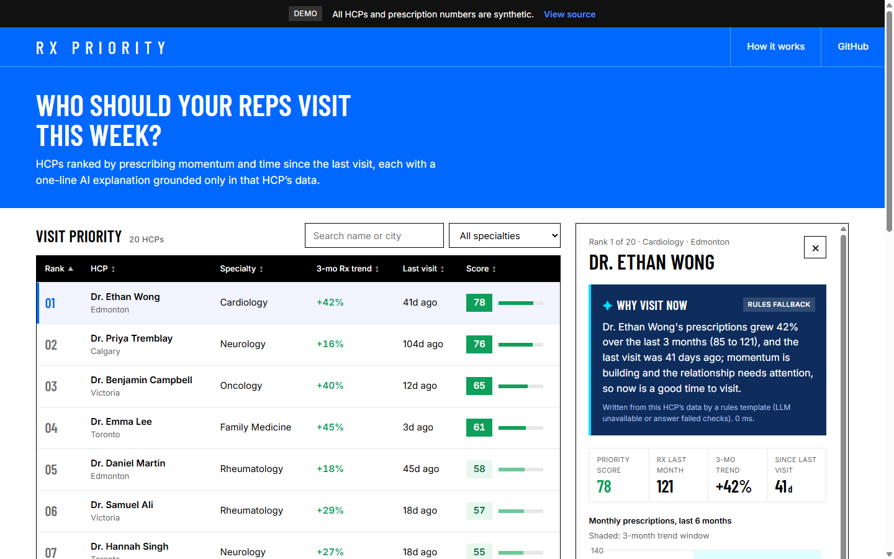

# Rx Priority: HCP visit ranking with grounded AI explanations

**Live demo:** https://hcp-priority-demo.vercel.app

A web app that ranks healthcare professionals (HCPs) by visit priority and shows a one-sentence AI explanation of why to visit each one. The explanation can only use that HCP's own data. **All data is synthetic.**



## What it does

- **Priority list.** 20 fake HCPs ranked by score, with a colour-coded score (green = high, grey = low), 3-month Rx trend and days since the last visit. You can search, filter by specialty and sort any column. Arrow keys move between rows.
- **Detail panel.** Opens on the #1 HCP by default, so the AI explanation shows on first load. Includes a 6-month prescription chart, a score breakdown and a shareable `?hcp=` URL.
- **Grounded AI explanation.** The LLM gets only that HCP's facts. Before the answer is shown, every number in it is checked against those facts. If any number isn't in the data, or the LLM fails, the app shows a rules-based sentence instead and labels it as a fallback.

## Architecture

```
React + TypeScript (Vite)            FastAPI (Python, Vercel serverless)
┌───────────────────────────┐        ┌────────────────────────────────────────┐
│ PriorityTable             │  GET   │ /api/doctors                           │
│  search / filter / sort   │ ─────▶ │   ScoringEngine: DuckDB SQL over JSON  │
│ DoctorPanel               │        │                                        │
│  AI explanation, chart,   │  GET   │ /api/doctors/{id}/explain              │
│  score breakdown          │ ─────▶ │   ExplanationService                   │
│ TanStack Query (caching,  │        │    ├─ in-memory TTL cache              │
│ retries, loading states)  │        │    ├─ LLMClient (timeout, retry,       │
└───────────────────────────┘        │    │   backoff + jitter, Retry-After)  │
                                     │    ├─ grounding check on numbers       │
                                     │    └─ rules-based fallback             │
                                     └────────────────────────────────────────┘
```

| Concern | Choice |
| --- | --- |
| Frontend | React 19, TypeScript, Vite, TanStack Query, Recharts (lazy-loaded) |
| Backend | Python, FastAPI |
| Scoring | Embedded **DuckDB**: one SQL query ranks all HCPs ([`backend/scoring.py`](backend/scoring.py)) |
| LLM | Anthropic or OpenAI over HTTP, picked by whichever API key is set ([`backend/llm.py`](backend/llm.py)) |
| Tests | pytest (scoring, retries, grounding, API) and Vitest + React Testing Library (table, panel, app flow) |
| Delivery | GitHub Actions CI, Vercel (static frontend + Python function) |
| Ops | `FEATURE_AI_EXPLAIN` flag, structured JSON request logs, `Server-Timing` header, `/api/health` |

## Scoring (a simplified stand-in for ML)

```
score = 100 × (0.6 × growth_signal + 0.4 × recency_signal)

growth_signal  = clamp((Rx_last_month − Rx_3_months_earlier) / Rx_3_months_earlier, −20% … +40%) → 0 … 1
recency_signal = min(days_since_last_visit / 90, 1)
```

Faster prescription growth and a longer gap since the last visit both raise the score. The rules are simple on purpose so the explanation is easy to check. A production system would use a trained model and many more signals (for example access, formulary status, channel preference and competitor activity).

## How the AI explanation avoids made-up numbers

1. `build_facts()` builds the only payload the model sees: name, specialty, rank, score, Rx values, % change and days since the last visit.
2. The system prompt says to use only those facts and never estimate figures.
3. `ungrounded_numbers()` pulls every number out of the answer and checks it against the facts (±1 for rounding). Any unknown number rejects the answer.
4. A rejected answer, a timeout, a 429/5xx after retries, or a missing API key all lead to `rules_explanation()`. That template is built from the same facts, and a test checks that it passes the same grounding check.
5. The response says which path was used (`source`, `fallbackReason`, `attempts`, `latencyMs`, `cached`), and the UI shows it.

## Run locally

```bash
# Backend (Python 3.12)
python -m venv .venv && .venv/bin/pip install -r requirements-dev.txt
.venv/bin/uvicorn backend.app:app --port 8011

# Frontend (Node 22+). Vite proxies /api to :8011
npm install
npm run dev
```

Optional: copy `.env.example` and set `ANTHROPIC_API_KEY` or `OPENAI_API_KEY` to turn on live LLM explanations.

```bash
.venv/bin/python -m pytest -q backend   # backend tests
npm test                                # frontend tests
python scripts/generate_data.py         # regenerate the synthetic dataset (fixed seed)
```

## What I'd do next

- Move the explanation cache to Redis so it's shared across serverless instances, and pre-generate explanations in a background queue when scores change.
- Virtualise the table rows and paginate on the server for territories with thousands of HCPs.
- Add an eval set of facts → explanations to track grounding failures and tone across prompt or model changes.

---

Portfolio project with synthetic data only. Not affiliated with any company.
